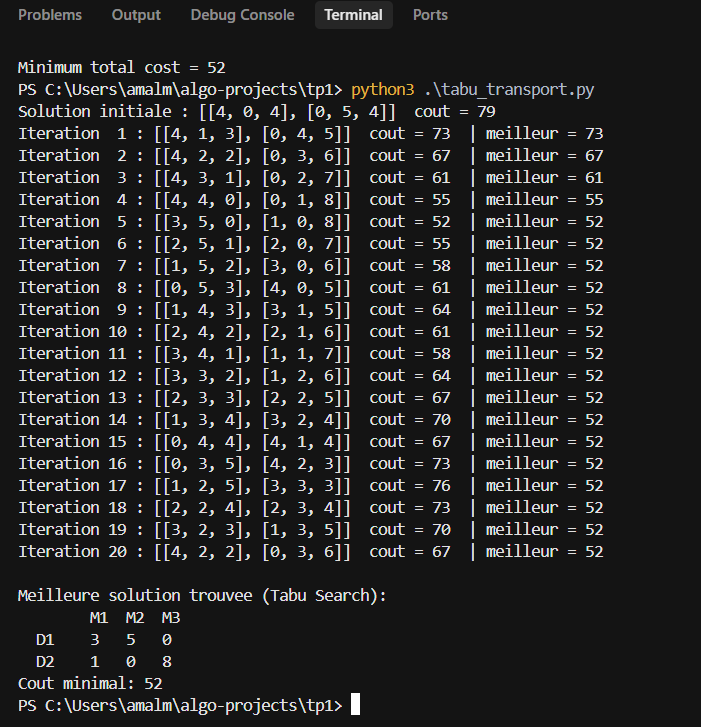

# Transport de containers (Génétique, Recuit simulé, Recherche tabou)

2 dépôts (D1 : 8 containers, D2 : 9 containers) livrent 3 magasins (M1 : 4, M2 : 5, M3 : 8).
Chaque trajet a un coût par container. Il faut trouver combien de containers envoyer de chaque dépôt à chaque magasin pour que le **coût total soit le plus petit**.
Une solution est une matrice **[[x11, x12, x13], [x21, x22, x23]]**. Le meilleur coût est **52**.

---

## Algorithme génétique (**transport_genetique.py**)

Écrit comme **ordonance_genetique.py**. On garde une **population** de 5 individus qui évolue pendant 30 générations.
- **Codage :** un individu est l'**ordre de remplissage** des 6 cases (dépôt, magasin). Chaque case reçoit le maximum possible, donc la solution respecte toujours les offres et les demandes.
- **Croisement :** on garde le début d'un parent, puis on complète dans l'ordre de l'autre parent (sans doublon).
- **Mutation :** on échange 2 cases dans l'ordre.
- **Sélection :** on trie par coût et on garde les meilleurs.

## Recuit simulé (**transport_recuit_simule.py**)

On travaille sur **une seule solution**. À chaque étape, on tire **un voisin au hasard**.
- Voisin **moins cher ou égal** : toujours accepté.
- Voisin **plus cher** : accepté avec la probabilité **exp(-delta / T)**.
- La température baisse à chaque palier (**T = alpha × T**, avec T0 = 20 et alpha = 0,9).

## Recherche tabou (**transport_tabu.py**)

On travaille aussi sur **une seule solution**. On part d'une solution valide aléatoire. À chaque itération :
1. on génère **tous les voisins** ;
2. on enlève les voisins **tabous** (déjà visités récemment) ;
3. on va vers le **voisin le moins cher**, même s'il est moins bon ;
4. on l'ajoute à la **liste tabou** (qui garde les 10 dernières solutions).



**Voisin (recuit et tabou) :** on déplace 1 container entre 2 dépôts et 2 magasins. Les totaux des lignes et des colonnes ne changent pas, donc le voisin reste valide.
```
              magasin j   magasin l
dépôt i          -1          +1
dépôt k          +1          -1
```

---

## Comparaison

| | Génétique | Recuit simulé | Tabou |
|---|---|---|---|
| Solutions en même temps | 5 | 1 | 1 |
| Voisins regardés à chaque étape | (croisement et mutation) | 1, au hasard | tous |
| Comment sortir d'un minimum local | croisement et mutation | hasard + température | liste tabou (mémoire) |
| Résultat | 52 | 52 | 52 |
