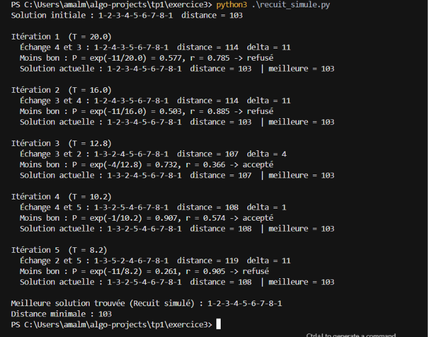

# Voyageur de commerce (Génétique, Recuit simulé, Recherche tabou)

Il faut trouver l'**ordre de visite des villes** (départ de la ville 1, retour à la ville 1) qui donne la **distance totale la plus courte**.
Une solution est une liste de villes, par exemple **[1, 2, 3, 4, 5, 6, 7, 8]** (= le tour 1-2-3-4-5-6-7-8-1).

---

## Algorithme génétique (**tsp_genetique.py**)

On garde une **population** de 70 tours qui évolue pendant 200 générations (10 villes).
- **Sélection :** tournoi (on tire 3 tours, on garde le plus court).
- **Croisement :** on garde le début du parent 1, puis on ajoute les villes manquantes dans l'ordre du parent 2 (probabilité 0,9). Chaque ville reste présente une seule fois.
- **Mutation :** on échange 2 villes (probabilité 0,3).
- **Élitisme :** le meilleur tour trouvé est toujours gardé.

**Interprétation :** la distance tombe à 20 dès la génération 20, puis ne bouge plus jusqu'à la génération 200 (l'élitisme garde le tour **[5, 2, 0, 1, 9, 3, 4, 7, 8, 6]**). Les villes sont numérotées à partir de 0. Ce n'est pas l'optimum : un calcul exhaustif de tous les tours donne 17. La population a convergé trop tôt vers un minimum local.

## Recuit simulé (**tsp_recuit_simule.py**)

On travaille sur **un seul tour** (8 villes). À chaque itération, on échange **2 villes au hasard**.
- Voisin **plus court ou égal** : toujours accepté.
- Voisin **plus long** : accepté avec la probabilité **exp(-delta / T)**.
- La température baisse à chaque itération (**T = alpha × T**, avec T0 = 20 et alpha = 0,8).

**Interprétation :** les voisins beaucoup plus longs (+11) sont refusés (itérations 1, 2 et 5), alors que les voisins un peu plus longs (+4 et +1) sont acceptés (itérations 3 et 4). La température baisse de 20 à 8,2, donc l'algorithme devient de plus en plus strict. Après 5 itérations, le meilleur tour reste celui de départ (**103**) : c'est trop peu pour atteindre l'optimum (98).

## Recherche tabou (**tsp_tabu.py**)

On travaille aussi sur **un seul tour** (8 villes). À chaque itération :
1. on génère **tous les voisins** (échange de 2 villes) ;
2. on enlève les voisins **tabous** (déjà visités récemment) ;
3. on va vers le **meilleur voisin**, même s'il est moins bon ;
4. on l'ajoute à la **liste tabou** (qui garde les 10 dernières solutions).

**Interprétation :** pendant 7 itérations, la distance reste au-dessus de 103 (de 106 à 113), car la recherche tabou va toujours vers le meilleur voisin autorisé, même s'il est moins bon. Cela lui permet de sortir du minimum local et de trouver **98** à l'itération 8, qui est le meilleur tour (**1-2-4-5-6-7-3-8-1**).

