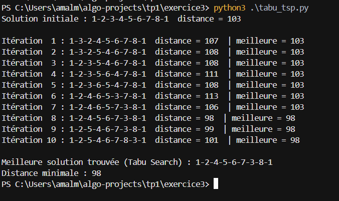

# Voyageur de commerce (Génétique, Recuit simulé, Recherche tabou)

Il faut trouver l'**ordre de visite des villes** (départ de la ville 1, retour à la ville 1) qui donne la **distance totale la plus courte**.
Une solution est une liste de villes, par exemple **[1, 2, 3, 4, 5, 6, 7, 8]** (= le tour 1-2-3-4-5-6-7-8-1).

---

## Algorithme génétique (**tsp_genetique.py**)

On garde une **population** de 70 tours qui évolue pendant 200 générations (10 villes).
- **Sélection :** tournoi (on tire 3 tours, on garde le plus court).
- **Croisement :** on garde le début du parent 1, puis on ajoute les villes manquantes dans l'ordre du parent 2 (probabilité 0,9). Chaque ville reste présente une seule fois.
- **Mutation :** on échange 2 villes (probabilité 0,3).
- **Élitisme :** le meilleur tour trouvé est toujours gardé.

## Recuit simulé (**tsp_recuit_simule.py**)

On travaille sur **un seul tour** (8 villes). À chaque itération, on échange **2 villes au hasard**.
- Voisin **plus court ou égal** : toujours accepté.
- Voisin **plus long** : accepté avec la probabilité **exp(-delta / T)**.
- La température baisse à chaque itération (**T = alpha × T**, avec T0 = 20 et alpha = 0,8).

## Recherche tabou (**tsp_tabu.py**)

On travaille aussi sur **un seul tour** (8 villes). À chaque itération :
1. on génère **tous les voisins** (échange de 2 villes) ;
2. on enlève les voisins **tabous** (déjà visités récemment) ;
3. on va vers le **meilleur voisin**, même s'il est moins bon ;
4. on l'ajoute à la **liste tabou** (qui garde les 10 dernières solutions).

---

## Comparaison

| | Génétique | Recuit simulé | Tabou |
|---|---|---|---|
| Solutions en même temps | 70 | 1 | 1 |
| Voisins regardés à chaque étape | (croisement et mutation) | 1, au hasard | tous |
| Comment sortir d'un minimum local | croisement et mutation | hasard + température | liste tabou (mémoire) |
