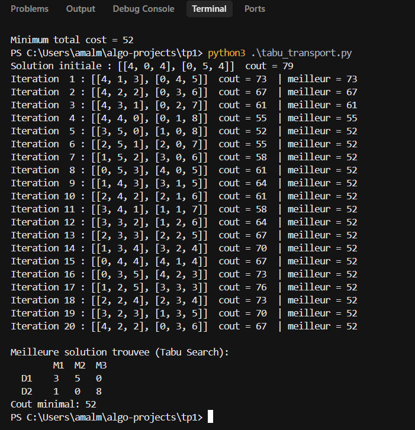

# TD1 - Exercice 2 : Problème de transport (Recherche tabou)


## 1. Le problème

Une entreprise possède **2 dépôts** (D1, D2) remplis de containers.
**3 magasins** (M1, M2, M3) commandent des containers.
Chaque container transporté coûte de l'argent, selon le trajet :

| Coût d'un container | M1 | M2 | M3 | Containers dans le dépôt |
|---|---|---|---|---|
| **D1** | 5 | 3 | 4 | **8** |
| **D2** | 6 | 7 | 2 | **9** |
| **Commandé par le magasin** | **4** | **5** | **8** | |

**Question :** combien de containers chaque dépôt doit-il envoyer à chaque magasin pour que le **coût total soit le plus petit possible** ?

Offre = 8 + 9 = **17** et demande = 4 + 5 + 8 = **17**.
Elles sont égales, donc le problème est **équilibré** : tous les containers sont envoyés et chaque magasin est entièrement servi.

---

## 2. Le modèle mathématique

**Variables :** `x_ij` = nombre de containers envoyés du dépôt `i` au magasin `j`.
Ce sont des **nombres entiers ≥ 0** (on ne peut pas envoyer 2,5 containers).

**Objectif (minimiser le coût total) :**
```
Z = 5·x11 + 3·x12 + 4·x13 + 6·x21 + 7·x22 + 2·x23
```

**Contraintes :**
```
x11 + x12 + x13 = 8      D1 envoie tous ses containers
x21 + x22 + x23 = 9      D2 envoie tous ses containers
x11 + x21       = 4      M1 reçoit ce qu'il a commandé
x12 + x22       = 5      M2 reçoit ce qu'il a commandé
x13 + x23       = 8      M3 reçoit ce qu'il a commandé
x_ij >= 0 et entier
```

---

## 3. Solution (Recherche tabou)

### 3.1 L'idée  

1. On part d'une **solution valide aléatoire**.
2. À chaque itération :
   - on liste tous les **voisins** (solutions obtenues avec un petit changement)
   - on enlève les voisins qui sont dans la **liste tabou** (déjà visités récemment)
   - on va vers le **voisin le moins cher qui reste, même s'il est moins bon**
   - on l'ajoute à la liste tabou
   - si c'est la meilleure solution jamais vue, on la garde en mémoire
3. On s'arrête après `nombre_iterations`, ou quand tous les voisins sont tabous.

Aller vers une solution moins bonne paraît étrange, mais c'est la force de la méthode :
elle permet de **sortir des minimums locaux** au lieu de rester bloquée.
La liste tabou l'empêche de revenir directement en arrière.


### 3.2 Les fonctions

| Fonction | Rôle |
|---|---|
| `calculer_cout_total` | additionne `coût × quantité` pour chaque case |
| `generer_solution_initiale` | crée une solution de départ aléatoire mais valide |
| `generer_voisins` | liste toutes les solutions obtenues en déplaçant 1 container |
| `tabu_search` | boucle principale : choisit le meilleur voisin non tabou |


#### `generer_voisins`
Un mouvement déplace 1 container entre 2 dépôts (i, k) et 2 magasins (j, l) :
```
              magasin j   magasin l
dépôt i          -1          +1
dépôt k          +1          -1
```
Les totaux des lignes et des colonnes ne changent pas, donc le voisin reste valide.
Le mouvement n'est possible que si `j != l` et si les cases qui perdent 1 sont `> 0`.

Exemple : les voisins de `[[3,5,0],[1,0,8]]` (coût 52) sont

| Mouvement de D1 | Voisin | Coût |
|---|---|---|
| M1 → M3 | `[[2,5,1],[2,0,7]]` | 55 |
| M2 → M1 | `[[4,4,0],[0,1,8]]` | 55 |
| M2 → M3 | `[[3,4,1],[1,1,7]]` | 58 |

Tous coûtent plus que 52, donc 52 est un minimum.

#### `tabu_search`
```python
voisins = [voisin for voisin in voisins if voisin not in tabu_list]
solution_actuelle = min(voisins, key=lambda x: calculer_cout_total(x, matrice_couts))
```
On enlève les voisins tabous, puis on prend celui qui a le **coût le plus bas**,
même s'il est moins bon que la solution actuelle.

### 3.3 Paramètres

En bas de `tabu_transport.py` :
```python
nombre_iterations = 20   # nombre d'itérations
taille_tabu = 10         # nombre de solutions récentes interdites
```

### 3.4 Exécution



