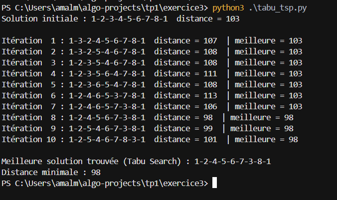
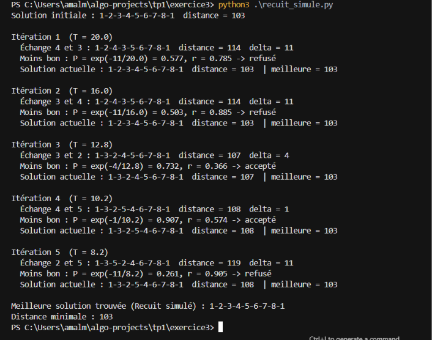

# TD1 - Exercice 3 : Voyageur de commerce (Recherche tabou + Recuit simulé)

# Le problème 

Il faut trouver l'**ordre de visite des 8 villes** (départ de 1, retour à 1) qui donne la **distance totale la plus courte**.

Les deux algorithmes utilisent les mêmes outils de base, définis dans `donnees.py`.

**Une solution** est une liste de villes :
```python
solution = [1, 2, 3, 4, 5, 6, 7, 8]      # = le tour 1-2-3-4-5-6-7-8-1
```

**On l'évalue** en additionnant les distances, retour à 1 compris :
```python
def calculer_distance_totale(solution):
    distance_totale = 0
    for i in range(len(solution) - 1):
        distance_totale += distance(solution[i], solution[i + 1])
    distance_totale += distance(solution[-1], solution[0])    # retour à la ville 1
    return distance_totale
```
```
1-2-3-4-5-6-7-8-1 = 14 + 13 + 11 + 11 + 15 + 9 + 13 + 17 = 103
```

**Un voisin** est la même solution avec **2 villes échangées** :
```
1-2-3-4-5-6-7-8   échange 2 et 3  ->  1-3-2-4-5-6-7-8   distance 107
1-2-3-4-5-6-7-8   échange 3 et 4  ->  1-2-4-3-5-6-7-8   distance 114
1-2-3-4-5-6-7-8   échange 7 et 8  ->  1-2-3-4-5-6-8-7   distance inf (pas de route 6-8)
```

Ce qui distingue les deux algorithmes, c'est **comment ils choisissent le voisin** et **quand ils acceptent une solution moins bonne**.

---

# 1. La recherche tabou

## L'idée

> À chaque étape, je regarde **tous** les voisins et je vais vers **le meilleur**, même s'il est moins bon que ma solution actuelle. Pour ne pas revenir en arrière, je note les solutions déjà visitées dans une **liste tabou** (interdite).

Il y a 4 étapes à chaque itération.

### Étape 1 : générer tous les voisins

```python
def generer_voisins(solution):
    voisins = []
    for i in range(1, len(solution)):          
        for j in range(i + 1, len(solution)):
            voisin = solution[:]                    
            voisin[i], voisin[j] = voisin[j], voisin[i]   
            voisins.append(voisin)
    return voisins
```
On échange chaque paire de villes parmi les villes 2 à 8, ce qui donne 7 × 6 / 2 = **21 voisins**.

### Étape 2 : enlever les voisins tabous

```python
voisins = [voisin for voisin in voisins if voisin not in tabu_list]
```

### Étape 3 : aller vers le meilleur voisin, même s'il est moins bon

```python
solution_actuelle = min(voisins, key=calculer_distance_totale)
```

### Étape 4 : mettre à jour la mémoire

```python
tabu_list.append(solution_actuelle)         

if distance_actuelle < meilleure_distance:   
    meilleure_solution = solution_actuelle[:]
    meilleure_distance = distance_actuelle
```

`tabu_list = deque(maxlen=10)` garde seulement les **10 dernières** solutions. Quand on en ajoute une 11ème, la plus ancienne sort de la liste.

## exécution 



La liste tabou empêche de tourner en rond. C'est ce qui permet de sortir d'un minimum local.

---

# 2. Le recuit simulé

## L'idée


> À chaque étape, je tire **un seul voisin au hasard**.
> - S'il est **meilleur**, je l'accepte toujours.
> - S'il est **moins bon**, je l'accepte **parfois**, avec une probabilité qui dépend de la **température T**.
>
> Au début T est grand : j'accepte souvent, donc j'explore. Ensuite T baisse : j'accepte de moins en moins.

## Le code

### Étape 1 : tirer un voisin au hasard

```python
i, j = random.sample(range(1, len(solution)), 2)    
voisin[i], voisin[j] = voisin[j], voisin[i]
```
Si le voisin passe par une route « - » (distance infinie), on tire un autre voisin.

### Étape 2 : calculer la différence

```python
delta = distance_voisin - distance_actuelle
```
- `delta < 0` : le voisin est **plus court**, donc meilleur.
- `delta > 0` : le voisin est **plus long**, donc moins bon.

### Étape 3 : accepter ou refuser

```python
if delta <= 0:
    accepte = True               # meilleur : toujours accepté
else:
    probabilite = math.exp(-delta / temperature)
    r = random.random()         # nombre au hasard entre 0 et 1
    accepte = r < probabilite    # accepté seulement si r < P
```

### Étape 4 : baisser la température

```python
temperature = alpha * temperature               # alpha = 0.8
```

## Exécution 




À chaque itération, on tire un voisin au hasard : s'il est un peu plus long (itérations 3 et 4 : +4 et +1), il a de grandes chances d'être accepté ; s'il est beaucoup plus long (itérations 1, 2 et 5 : +11), il est refusé. Comme T baisse à chaque itération, l'algorithme devient de plus en plus strict. Après 5 itérations, le meilleur tour reste celui de départ (**103**), car c'est trop peu pour atteindre l'optimum (98).

---

# 3. Comparaison


| | Recherche tabou | Recuit simulé |
|---|---|---|
| Combien de voisins à chaque étape ? | tous (21) | un seul, au hasard |
| Pourquoi accepter une solution moins bonne ? | c'est le meilleur voisin autorisé | la chance : `r < exp(-delta/T)` |
| Comment éviter de tourner en rond ? | la liste tabou (mémoire) | le hasard et la température |
| Résultat ici | **98** (optimum) | environ 103 en 5 itérations |

**Conclusion :** La recherche tabou le fait grâce à sa **mémoire**, le recuit simulé grâce au **hasard contrôlé par la température**.
