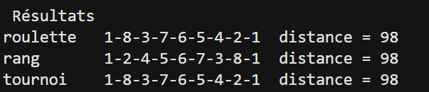

# TD1 - Exercice 3 : Voyageur de commerce par algorithme génétique

Trouver l'**ordre de visite des 8 villes** (départ et retour à la ville 1) avec la **distance totale la plus courte**. 

---

# 1. Le principe


| Terme | Ici |
|---|---|
| **Individu** | un tour, la ville 1 toujours en tête : [1, 8, 3, 7, 6, 5, 4, 2] |
| **Fitness** | 1 / distance : tour court = bonne note. Route « - » (INF) : note = 0 |
| **Population** | 20 tours aléatoires valides |
| **Paramètres** | 10 générations, croisement pc = 0.8, mutation pm = 0.2 |

**Une génération :**
1. **Élitisme** : le meilleur tour passe directement.
2. **Sélection** de 2 parents.
3. **Croisement** (80 %) → 2 enfants.
4. **Mutation** (20 %) : échange de 2 villes.
5. On recommence jusqu'à avoir 20 tours.

---

# 2. Les sélections

| Méthode | Idée |
|---|---|
| **Roulette** | probabilité **proportionnelle à la fitness** (une roue où chaque tour a une part selon sa note) |
| **Rang** | on classe du pire (rang 1) au meilleur (rang N), probabilité **proportionnelle au rang** |
| **Tournoi** | on tire **3 tours** au hasard, **le plus court gagne** |


---

# 3. Le croisement (simple, 1 point)

L'enfant garde **le début du parent 1**, puis complète avec **les villes manquantes dans l'ordre du parent 2**:
```
Parent 1 : 1 2 3 4 | 5 6 7 8
Parent 2 : 1 8 3 7 | 6 5 4 2
Enfant 1 : 1 2 3 4 | 8 7 6 5
Enfant 2 : 1 8 3 7 | 2 4 5 6
```

# 4. La mutation

Échange de 2 villes au hasard (la ville 1 ne bouge pas) :
```
1-3-8-7-6-5-4-2-1  (100)   échange 3 et 8  ->  1-8-3-7-6-5-4-2-1  (98)
```

---

# 5. Résultats

Le tour trouvé par le rang est le même que les autres, parcouru dans l'autre sens.

### Sélection par roulette


### Sélection par rang


### Sélection par tournoi


### Comparaison finale



